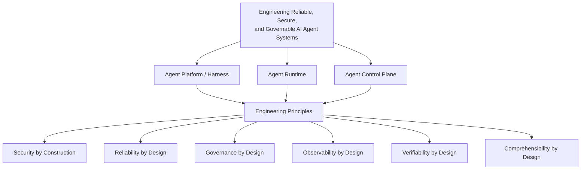

# Study

**Engineering Reliable, Secure, and Governable AI Agent Systems**

不確実で非決定的なAIエージェントを、安全かつ信頼性高く実行・運用するためのPlatform / Runtime / Control Planeを設計・構築すること。

## Engineering Domains

### Agent Platform / Harness

エージェントを組み立て、協調させ、タスクを遂行させる基盤。

- Orchestration
- Multi-Agent Coordination
- Tool Management
- Context / Memory
- Planning
- Evaluation

### Agent Runtime

エージェントを安全かつ安定して実行する基盤。

- Execution Lifecycle
- Durable Execution
- Sandbox
- Isolation
- Tool Execution
- Resource Management
- Fault Recovery

### Agent Control Plane

エージェントの権限・行動・運用を統制する基盤。

- Identity
- Authentication
- Authorization
- Delegation
- Capability
- Policy Enforcement
- Approval
- Audit
- Attestation

## Engineering Principles

- Security by Construction
    - 危険な操作を構造的に制限する
    - Least Privilege、Capability、Sandbox、Reference Monitor、Isolation
- Reliability by Design
    - 失敗や不確実性があっても動作を維持・回復する
    - Durable Execution、Idempotency、Retry、Fault Isolation、Recovery
- Governance by Design
    - 誰が何を許可し、何が実行されたかを統制する
    - Identity、Delegation、Policy、Approval、Audit
- Observability by Design
    - 内部の実行状況を把握し、問題を診断できるようにする
    - Tracing、Logging、Metrics、Execution History
- Verifiability by Design
    - 要求された性質が満たされているか検証できるようにする
    - Evaluation、Invariant Checking、Policy Testing、Adversarial Testing
- Comprehensibility by Design
    - 人間がシステムの構造・責務・振る舞いを容易に理解し、変更の影響を推論できるようにする
    - Separation of Concerns、Explicit Boundaries、Local Reasoning、Cognitive Simplicity、Information Hiding、Single Level of Abstraction Principle
